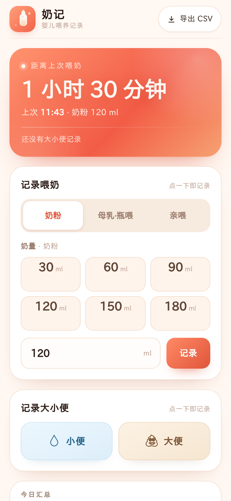

# 奶记 · 婴儿喂养记录

给新手爸妈用的手机 Web App：**一键记录**宝宝喝了多少奶（奶粉 / 母乳瓶喂 / 亲喂）、大小便，首页实时显示**距离上次喂奶 X 小时 X 分钟**。

- 后端：Node.js 内置 `node:http` + `node:sqlite`，**零第三方依赖**，不需要 `npm install`，没有构建步骤。
- 前端：原生 HTML/CSS/ES Module 单页，手机优先（也适配桌面），深色模式，可「添加到主屏幕」。
- 数据：SQLite 单文件 `data/baby.db`，随手复制即备份。
- 局域网可用：手机连同一 WiFi 打开 `http://<电脑 IP>:3000` 就能用。

## 功能

| 功能 | 说明 |
| --- | --- |
| 🍼 一键喂奶 | 选奶粉 / 母乳（瓶喂），点 30 · 60 · 90 · 120 · 150 · 180 ml 立即记录，也可自定义奶量 |
| 🤱 一键亲喂 | 不记奶量，点一下即可 |
| 💧💩 一键大小便 | 小便 / 大便分开记录（API 支持「混合」） |
| ⏱ 距上次喂奶 | 首页大字实时刷新「3 小时 25 分钟」，同时显示上次喂奶详情与距上次换尿布时间 |
| 📊 今日汇总 | 喂奶次数、奶量合计、亲喂次数、大小便次数 |
| 🕘 时间线 | 按天分组的历史记录，可删除、记录后 5 秒内可撤销 |
| 📤 导出 CSV | 一键导出全部记录（Excel 可直接打开，带 BOM 不乱码） |

## 界面预览

| 手机 · 浅色 | 手机 · 深色 |
| --- | --- |
|  |  |

记录后的撤销 toast、空状态、加载失败、320px 窄屏、桌面宽度等更多截图见 [docs/screenshots/](docs/screenshots/)，浏览器端到端验收详见 [docs/qa-report.md](docs/qa-report.md)。

## 快速开始

项目需要 **Node.js ≥ 22.13**（用到内置 `node:sqlite`；推荐 Node 24）。

### 方式一：Nix（本项目已带 flake）

```bash
cd baby-milk-tracker
nix develop          # 或装有 nix-direnv 时：direnv allow
npm start            # 启动，默认 http://0.0.0.0:3000
```

### 方式二：已有 Node 环境

```bash
cd baby-milk-tracker
node src/server.js   # 无需 npm install
```

启动后终端会打印本机与局域网地址，例如：

```
  🍼 奶记 · 婴儿喂养记录已启动
     数据库: /home/you/Project/nodejs/baby-milk-tracker/data/baby.db
     打开页面:
       http://localhost:3000
       http://192.168.1.23:3000
```

手机连同一个 WiFi，浏览器打开局域网地址即可；iOS Safari「分享 → 添加到主屏幕」、Android Chrome「添加到主屏幕」后可像原生 App 一样使用。

## 配置（环境变量）

| 变量 | 默认值 | 说明 |
| --- | --- | --- |
| `PORT` | `3000` | 监听端口 |
| `HOST` | `0.0.0.0` | 监听地址（想只允许本机访问就设为 `127.0.0.1`） |
| `DB_PATH` | `./data/baby.db` | SQLite 文件路径 |

```bash
PORT=8080 DB_PATH=~/baby.db npm start
```

## 数据与备份

- 所有记录都在一个 SQLite 文件里（默认 `data/baby.db`），**直接复制该文件**即为完整备份（复制前建议停服，或连 `-wal`/`-shm` 一起复制）。
- 也可以随时从页面右上角「导出 CSV」拿一份人类可读的记录。
- `data/` 已加入 `.gitignore`，不会被提交到 git。

## 开发

```bash
npm start        # 启动
npm run dev      # 启动 + 文件改动自动重启（node --watch）
npm test         # 跑测试（node --test，自动发现 test/*.test.js）
```

浏览器端到端验收（真实 headless Chrome + CDP，覆盖记录/撤销/删除/分页/深色/窄屏/失败重试等 343 条断言）：

```bash
node scripts/browser-e2e.mjs        # 需要本机有 Chrome，约 22s，exit 0 = 全部通过
```

测试使用临时数据库，不会碰 `data/`。

## 目录结构

```
baby-milk-tracker/
├── src/
│   ├── server.js        # HTTP 服务：路由、校验、静态托管（无框架）
│   ├── db.js            # SQLite schema + Store（node:sqlite，单表 events）
│   ├── state.js         # /api/state 聚合（今日汇总 / 上次喂奶 / 最近记录）
│   └── util/time.js     # 时区「当天」边界计算
├── public/
│   ├── index.html       # 单页
│   ├── app.css          # 样式（手机优先 / 深色模式）
│   ├── app.js           # 交互逻辑（ES module）
│   ├── lib/format.js    # 共享格式化纯函数（浏览器与测试共用）
│   ├── manifest.webmanifest
│   └── icon.svg
├── test/                # node:test 单元 + HTTP 集成测试
├── scripts/             # 浏览器端到端检查脚本（QA）
├── docs/
│   ├── CONTRACT.md      # 前后端接口/实现契约（唯一事实来源）
│   └── qa-report.md     # QA 报告与截图
└── data/                # 运行时生成的 SQLite（gitignore）
```

## API 速览

完整契约（字段、校验、错误码）见 [docs/CONTRACT.md](docs/CONTRACT.md)。

| 方法 | 路径 | 说明 |
| --- | --- | --- |
| `GET` | `/api/health` | 健康检查 |
| `GET` | `/api/state?tzOffset=-480` | 首页聚合：上次喂奶 / 上次大小便 / 今日汇总 / 最近 30 条 |
| `POST` | `/api/feedings` | 记录喂奶 `{feedType: formula\|breast_milk\|breast_direct, amountMl?}` |
| `POST` | `/api/diapers` | 记录大小便 `{diaperKind: pee\|poop\|mixed}` |
| `GET` | `/api/events?limit=50&before=&beforeId=` | 历史记录（游标分页） |
| `DELETE` | `/api/events/:id` | 删除一条记录 |
| `GET` | `/api/export.csv` | 导出全部记录 |

## 常驻运行（可选）

```bash
nohup node src/server.js > milk.log 2>&1 &
```

或用自己的进程管理器（systemd / pm2 / tmux）。单用户家庭局域网使用即可，未做多用户与鉴权——**不建议直接暴露到公网**。
