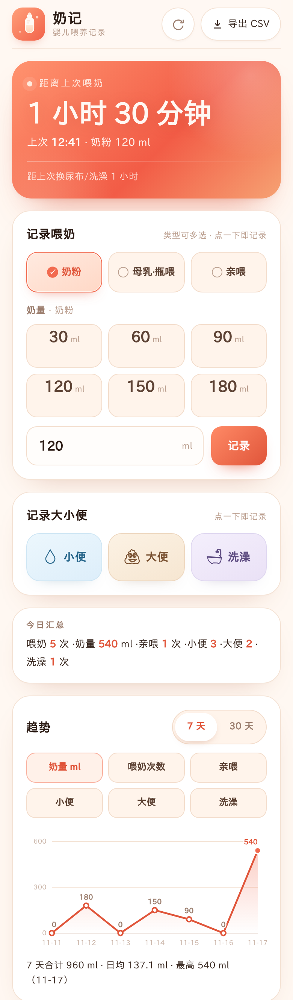
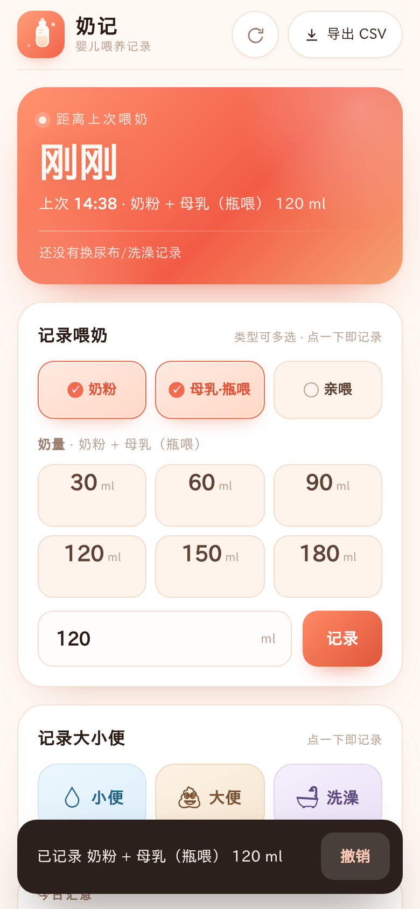
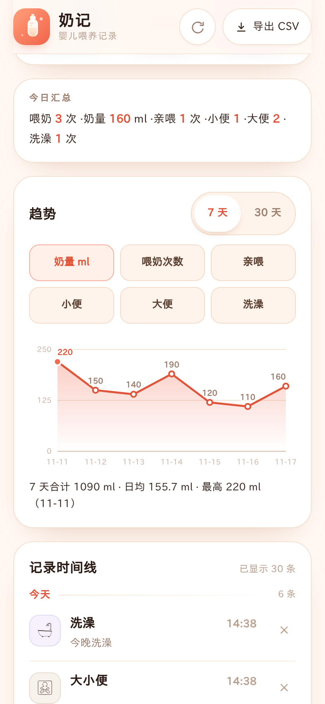
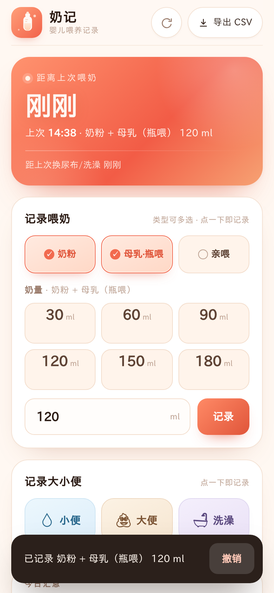
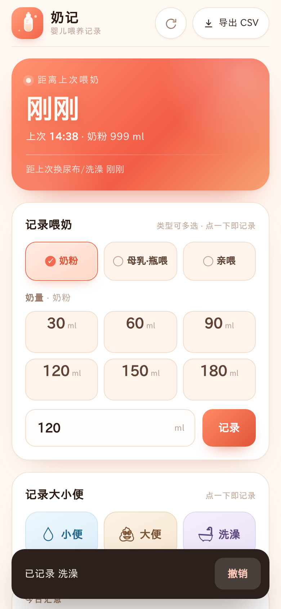
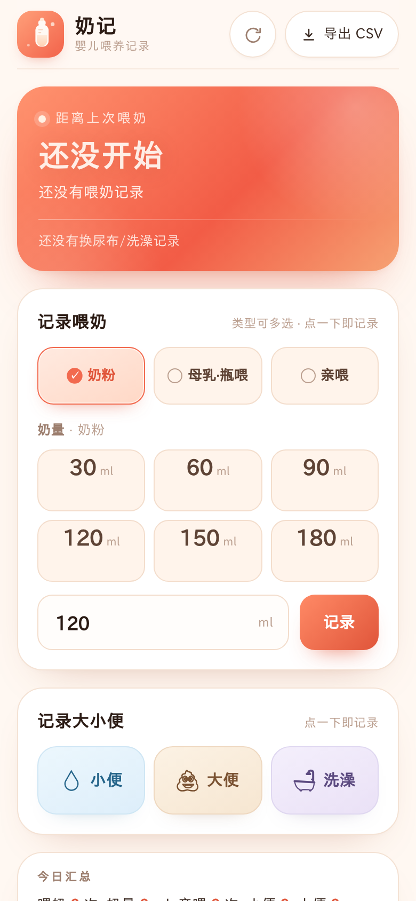

# 奶记 · 婴儿喂养记录

给新手爸妈用的喂养记录工具：**手机打开网页一键记录**，**电脑上敲命令记录/查看**，首页实时显示**距离上次喂奶 X 小时 X 分钟**。

v2 已拆成前后端分离的三部分，彼此只通过 HTTP API 通信：

| 部分 | 说明 |
| --- | --- |
| `server/` | 纯 HTTP API + SQLite（Node 内置 `node:http` / `node:sqlite`，零第三方依赖、无需构建） |
| `web/` | 纯静态前端（原生 HTML/CSS/ESM，可部署到任意静态主机），API 地址可配置 |
| `cli/` | 命令行工具 `naiji`（Node 内置 fetch，零依赖），电脑上记录与查看 |

数据存一个 SQLite 文件（默认 `data/baby.db`），复制即备份。手机和 CLI 可以连同一个后端，记录实时同步。

<p align="center">
  
</p>

## 功能

| 功能 | 说明 |
| --- | --- |
| 🍼 一键喂奶（多选） | **奶粉 / 母乳（瓶喂）/ 亲喂 可多选**（如「奶粉 + 母乳 120 ml」「亲喂 + 奶粉 60 ml」），选好类型点 30/60/90/120/150/180 ml 立即记录，也可自定义奶量；亲喂无需奶量 |
| 💧💩 一键大小便 | 小便 / 大便（API 支持「混合」） |
| 🛁 一键洗澡 | 「洗澡」也是独立记录；**洗澡会一并重置「距上次换尿布」计时**（显示为「距上次换尿布/洗澡」） |
| ⏱ 距上次喂奶 | 大字实时刷新「3 小时 25 分钟」，另显示上次详情、距上次换尿布/洗澡时间；**浏览器标签标题**也显示「距上次 X · 奶记」，切标签也能瞥一眼 |
| 📈 趋势折线图 | 最近 **7 天 / 30 天**按天统计：奶量、喂奶次数、亲喂、小便、大便、洗澡，SVG 手绘折线（零依赖），带每日数值/合计/日均/最高 |
| 📊 今日汇总 | 喂奶次数、总奶量、亲喂次数、大小便次数、洗澡次数 |
| 🕘 时间线 | 按天分组，删除、记录后 5 秒内撤销 |
| 🔄 多人实时同步 | 家里几个人同时用：谁记录/删除，所有打开的页面**无需刷新**立即同步（SSE 长连接）；顶栏还有手动「刷新」按钮兜底 |
| 📤 导出 CSV | 带 BOM，Excel 可直接打开不乱码 |
| 💻 CLI | `naiji` 无参数即看状态；`naiji f 120` / `naiji p` / `naiji bath` 记录；`naiji log` 看历史；支持 `--ago` 回溯补记 |
| 🔗 前后端分离 | web 可单独托管，跨源访问 API（已内置 CORS）；手机、电脑 CLI 共用一个后端 |

## 快速开始

需要 **Node.js ≥ 22.13**（推荐 Node 24；用到内置 `node:sqlite`）。

### 方式一：Nix（本项目带 flake，推荐）

```bash
cd baby-milk-tracker
nix develop          # 或装有 nix-direnv 时：direnv allow
npm start            # 启动 server（默认同时托管 web）→ http://0.0.0.0:3000
```

进入 devShell 后 `naiji` 命令已可用（指向工作区里的 CLI）。

### 方式二：已有 Node 环境

```bash
cd baby-milk-tracker
node server/src/server.js        # 无需 npm install
node cli/bin/naiji.mjs status    # CLI
```

启动后终端会打印本机与局域网地址：

```
  🍼 奶记 API 已启动
     数据库: .../baby-milk-tracker/data/baby.db
     API:    http://localhost:3000/api/health
     网页:
       http://localhost:3000
       http://192.168.1.23:3000
     CLI:    naiji status --server http://127.0.0.1:3000
```

手机连同一 WiFi 打开局域网地址即可；iOS「分享 → 添加到主屏幕」、Android Chrome「添加到主屏幕」后可像 App 一样用。

### 方式三：Docker（后端 + web 单容器打包，推荐给家用 NAS / 服务器）

```bash
cd baby-milk-tracker
docker compose up -d --build     # 默认 http://127.0.0.1:3000
docker compose ps                # 等 STATUS 出现 (healthy)
docker compose logs -f           # 启动日志（含局域网访问地址）
```

- 单容器同时提供 API 和 web 页面；镜像 `naiji:2.0.0`（Node 24 alpine，零依赖、无构建步骤、非 root、内置健康检查），约 173 MB
- 数据在 Docker 命名卷 `naiji_naiji-data`（容器内 `/app/data/baby.db`），`docker compose down` 不会丢数据
- 改端口 / 时区：`NAIJI_PORT=8080 docker compose up -d`、`TZ=Asia/Tokyo docker compose up -d`
- 容器内也带 CLI：`docker compose exec naiji naiji status`
- 备份 / 恢复 / 迁移宿主机旧数据 / 前后端分离部署，详见 [docs/DOCKER.md](docs/DOCKER.md)

## CLI 用法（电脑上）

```bash
naiji                     # = naiji status：距离上次喂奶 + 上次详情 + 今日汇总
naiji f 120               # 喂奶 120ml（默认奶粉）
naiji f 90 -t breast_milk # 母乳（瓶喂）90ml
naiji f 60 -t formula -t breast_direct   # 多选标签：亲喂 + 补充 60ml 奶粉
naiji f --direct          # 只亲喂（无奶量）
naiji f 120 --ago 30      # 补记 30 分钟前的那次
naiji f 120 --at "20:30"  # 补记今天 20:30
naiji p / naiji o         # 小便 / 大便
naiji bath                # 洗澡（会重置「距上次换尿布/洗澡」计时）
naiji log -n 20           # 最近 20 条
naiji today               # 今天的时间线 + 汇总
naiji undo                # 删掉最近一条（TTY 下会确认）
naiji export --out milk.csv
naiji config set server http://192.168.1.23:3000   # 指向家里那台后端
naiji config show
```

- 类型别名：`formula|f|奶粉`、`breast_milk|b|母乳`、`breast_direct|d|亲喂`。
- 服务器地址优先级：`--server` > 环境变量 `NAIJI_SERVER` > `~/.config/naiji/config.json` > `http://127.0.0.1:3000`。
- `--json` 输出机器可读结果，方便脚本；`--no-color` / 非 TTY 自动降级。
- 退出码：`0` 成功、`1` API/网络错误、`2` 用法错误。

## 前后端分离部署（可选）

默认「一个进程搞定」（server 顺便托管 `web/`），家庭内网最省事。想分开部署：

```bash
# 1) 后端：只开 API
SERVE_WEB=0 CORS_ORIGINS='*' PORT=3000 node server/src/server.js

# 2) 前端：任意静态服务器托管 web/ 目录（这里用自带的零依赖静态服务器）
node scripts/serve-web.mjs --port 8080 --api http://192.168.1.23:3000
# 打开 http://192.168.1.23:8080/?api=http://192.168.1.23:3000
```

- API 基址可在 `web/config.js`（`window.NAIJI_CONFIG.apiBase`）、URL 参数 `?api=`、或 localStorage 中配置。
- 后端 CORS 默认 `CORS_ORIGINS=*`；要收紧就设成具体来源，如 `CORS_ORIGINS=http://192.168.1.23:8080`。
- 部署到 nginx/GitHub Pages 等静态主机时，把 `apiBase` 指向后端地址即可（后端需允许该来源 CORS）。
- Docker 部署想分离：给服务加 `SERVE_WEB: "0"`，web 交给 nginx/静态主机；示例见 [docs/DOCKER.md](docs/DOCKER.md) 第 3 节。

## 配置（server 环境变量）

| 变量 | 默认值 | 说明 |
| --- | --- | --- |
| `PORT` | `3000` | 监听端口 |
| `HOST` | `0.0.0.0` | 监听地址（只想本机访问设 `127.0.0.1`） |
| `DB_PATH` | `./data/baby.db` | SQLite 文件路径 |
| `SERVE_WEB` | `1` | `0` = 纯 API，不托管静态文件 |
| `WEB_DIR` | `<repo>/web` | 静态目录 |
| `CORS_ORIGINS` | `*` | 允许的来源，逗号分隔 |

## 数据与迁移

- 所有记录都在一个 SQLite 文件里（默认 `data/baby.db`），**复制该文件即完整备份**（建议停服后复制，或连同 `-wal`/`-shm` 一起）。
- 也可以从网页右上角「导出 CSV」或 `naiji export` 拿人类可读备份。
- **旧库自动迁移**：v1（单值 `feed_type`）→ v3 自动转成 `feedTypes` 数组；v2 → v3 自动放宽事件类型以支持「洗澡」（`user_version` 置 3）。历史记录、时间与 id 都不变，无需手动操作。
- `data/` 已 gitignore。

## 开发

```bash
npm start          # 启动后端（顺带托管 web/）
npm run dev        # 开发模式（node --watch，改后端自动重启）
npm test           # 跑测试：server 单元/集成 + web 纯函数 + CLI（node --test 自动发现）
npm run e2e        # 浏览器端到端验收（需本机 Chrome，见 scripts/browser-e2e.mjs）
npm run web        # 独立静态托管 web/（验证前后端分离，默认 8080）
node cli/bin/naiji.mjs help   # CLI 帮助
```

## 目录结构

```
baby-milk-tracker/
├── server/src/
│   ├── server.js        # HTTP API、校验、CORS、可选静态托管（无框架）
│   ├── db.js            # SQLite schema v2 + v1→v2 自动迁移 + Store
│   ├── state.js         # /api/state 聚合
│   ├── feed-types.js    # 类型枚举 / 标签文案 / 校验辅助
│   └── util/time.js     # 时区「当天」边界
├── web/
│   ├── index.html / app.css / app.js
│   ├── config.js        # window.NAIJI_CONFIG = { apiBase: '' }
│   ├── lib/api.js       # API 基址解析 + 请求封装
│   └── lib/format.js    # 共享格式化纯函数（浏览器与测试共用）
├── cli/
│   ├── bin/naiji        # 命令入口（sh 启动器）
│   ├── bin/naiji.mjs    # CLI 主程序
│   └── src/             # 参数解析 / 配置 / HTTP client / 渲染
├── test/                # server + web/lib 测试（node:test）
├── cli/test/            # CLI 测试
├── scripts/             # serve-web.mjs、browser-e2e.mjs（QA）
├── Dockerfile           # 生产镜像：后端 API + web 前端 + CLI（非 root、健康检查）
├── docker-compose.yml   # 一键部署（命名卷 naiji_naiji-data 持久化 SQLite）
├── .dockerignore
├── docs/
│   ├── CONTRACT.md      # 前后端 + CLI 接口契约（唯一事实来源）
│   ├── DOCKER.md        # Docker 部署/备份恢复/迁移/前后端分离详解
│   ├── qa-report.md     # v2 验收报告
│   └── qa-report-v1.md  # v1 验收报告（归档）
└── data/                # 运行时生成的 SQLite（gitignore）
```

## API 速览

完整契约（字段、校验、错误码、CORS）见 [docs/CONTRACT.md](docs/CONTRACT.md)。

| 方法 | 路径 | 说明 |
| --- | --- | --- |
| `GET` | `/api/health` | 健康检查 |
| `GET` | `/api/state?tzOffset=-480` | 首页聚合：上次喂奶 / 上次大小便 / 上次洗澡 / 今日汇总 / 最近 30 条 |
| `POST` | `/api/feedings` | 记录喂奶 `{feedTypes: ["formula","breast_milk"], amountMl: 120}` |
| `POST` | `/api/diapers` | 记录大小便 `{diaperKind: "pee"\|"poop"\|"mixed"}` |
| `POST` | `/api/baths` | 记录洗澡 `{note?, happenedAt?}` |
| `GET` | `/api/stats?days=7&tzOffset=-480` | 最近 N 天（1–90，默认 7）按天聚合，用于趋势图 |
| `GET` | `/api/events?limit=50&before=&beforeId=` | 历史记录（复合游标分页） |
| `GET` | `/api/events/stream` | **SSE 实时推送**：任何一端新增/删除记录后广播给所有页面 |
| `DELETE` | `/api/events/:id` | 删除一条记录 |
| `GET` | `/api/export.csv` | 导出全部记录 |

## 更多截图

| 手机 · 多选记录 | 手机 · 趋势折线图 | 手机 · 深色模式 |
| --- | --- | --- |
|  |  |  |
| **前后端分离 · 跨源部署** | **洗澡记录** | **空状态** |
|  |  |  |

更多截图见 [docs/screenshots/](docs/screenshots/)，浏览器 + CLI + 跨源/SSE 的端到端验收（950 条断言）详见 [docs/qa-report.md](docs/qa-report.md)。

## 常驻运行（可选）

```bash
nohup node server/src/server.js > milk.log 2>&1 &
```

或用自己的进程管理器（systemd / tmux）。单用户家庭内网使用，未做多用户与鉴权——**不建议直接暴露到公网**。

## License

[MIT](LICENSE) © 2026 Nyk Ma
